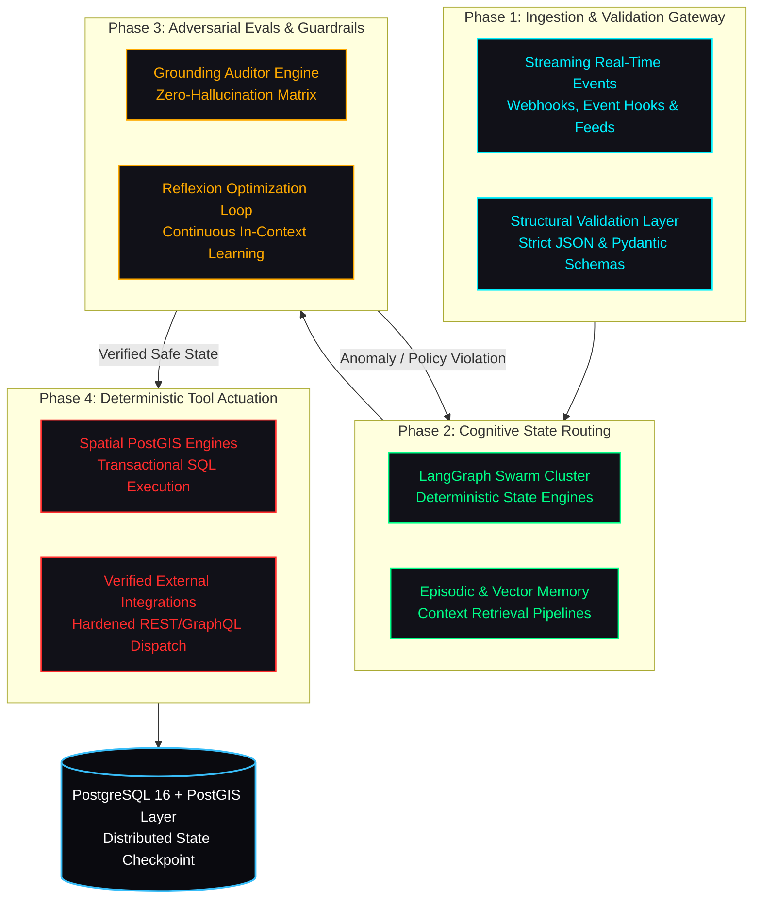

# ALI ABDULLAH
### Autonomous Systems & Forward Deployed AI Engineer

 

 

  <b>Architecting deterministic multi-agent swarms, validation harnesses, and production-grade enterprise data architectures.</b> 
  Bridging unstructured foundation models with relational, spatial, and mission-critical execution runtime environments.

---

## Core Engineering Tenets

Every system I architect, build, and deploy adheres to three foundational axioms:

### `01 //` Deterministic Actuation over Stochastic Guesswork
> **Axiom**: Autonomous agent architectures cannot rely on unstable prompt engineering heuristics in production environments. Every generative execution flow is strictly constrained by validated Pydantic schemas, bounded LangGraph DAG execution tokens, and robust transaction rollback rules.

### `02 //` Evaluation-Driven Reliability (Evals First)
> **Axiom**: LLM inference without automated runtime verification introduces severe enterprise risk. My architectures deploy programmatic grounding auditors, adversarial hallucination filters, and real-time latency telemetry directly on the execution pipeline before committing pipeline state.

### `03 //` Enterprise-Grade Latency & State Management
> **Axiom**: Advanced AI foundation models are only as scalable as their underlying data orchestration layer. I engineer asynchronous multi-threaded backend pipelines leveraging PostgreSQL, PostGIS, TimescaleDB, and AsyncIO to enforce microsecond data mutation guarantees.

---

## Autonomous Agent Systems Blueprint

Below is the high-performance architectural lifecycle deployed across my multi-agent platforms and automated workflow systems:

---

## Technical Stack & Production Arsenal

<table>
  <thead>
    <tr>
      <th width="30%">Domain</th>
      <th width="70%">Technologies, Tools & Enterprise Frameworks</th>
    </tr>
  </thead>
  <tbody>
    <tr>
      <td><b>Agentic Systems & LLM Engines</b></td>
      <td>
        <code>LangGraph</code> &bull; <code>LangChain</code> &bull; <code>n8n Workflows</code> &bull; <code>Google GenAI SDK</code> &bull; <code>PydanticAI</code> &bull; <code>FastEmbed</code> &bull; <code>OpenAI API</code> &bull; <code>Automated Model Evals</code>
      </td>
    </tr>
    <tr>
      <td><b>Runtime Environments & Systems</b></td>
      <td>
        <code>Python 3.12+</code> &bull; <code>TypeScript / Node.js</code> &bull; <code>FastAPI</code> &bull; <code>AsyncIO / Uvicorn</code> &bull; <code>Next.js 15 App Router</code> &bull; <code>REST / WebSockets</code>
      </td>
    </tr>
    <tr>
      <td><b>Data Engine & Spatial Architectures</b></td>
      <td>
        <code>PostgreSQL 16</code> &bull; <code>PostGIS 3.4+</code> &bull; <code>TimescaleDB Vector</code> &bull; <code>GeoAlchemy2</code> &bull; <code>Redis Cache</code> &bull; <code>SQLAlchemy Async</code>
      </td>
    </tr>
    <tr>
      <td><b>DevSecOps & System Reliability</b></td>
      <td>
        <code>Docker Containerization</code> &bull; <code>GitHub Actions CI/CD</code> &bull; <code>Linux Admin</code> &bull; <code>SLSA Provenance Tracking</code> &bull; <code>CodeQL Security Scanning</code>
      </td>
    </tr>
  </tbody>
</table>

---

## Featured Production Engineering

### [n8n-nodes-jev-ai](https://github.com)
*Production-ready TypeScript enterprise workflow integration node published directly to the npm registry.*

- **Ecosystem Architecture**: Native custom node for local, self-hosted, and cloud-based n8n automation instances.
- **Enterprise Security Hardening**: Engineered with explicit guardrails preventing prototype pollution vulnerabilities, SSRF surface risks, and unvalidated large payloads. Built with strict SLSA compilation provenance.
- **Production Grounding**: Complete automated testing matrices, verified community documentation structures, and dynamic deployment handlers.
- **Package Registry Entry**: Deployed and maintained actively as [`n8n-nodes-jev-ai`](https://npmjs.com) on the global npm package registry.

---

## Systems Architecture Deep Dive

<b>INTERACTIVE SPECS: Mission-Critical Agent Design Standards</b>

 

### 1. Bounded Graphical Execution
Every autonomous workflow loop operates inside an explicitly iteration-bounded Directed Acyclic Graph (DAG) using LangGraph and custom n8n logic gates. If an agent structure registers more than 5 recursive calls without state convergence, a circuit breaker trips automatically, redirecting execution state payloads to human-in-the-loop processing queues.

### 2. PostGIS Spatial Operations
Unlike standard conversational text-based RAG engines, my spatial engineering processes combine LLM routing with exact geography queries (`ST_DWithin`, `ST_Contains`). This guarantees automated pipelines compute precise geographic bounds and logistic data maps with zero geometric hallucinations.

### 3. Asynchronous Optimization & Evals
Completed production pipelines constantly cross-examine structured outputs against programmatic truth sheets. Discovered data insights are automatically recorded in localized episodic memory tables, generating immediate runtime contextual upgrades for future parallel swarm runs.

---

## Direct Transmission / Communications

I actively collaborate with forward-deployed engineering structures, global software automation teams, and institutions building high-stakes autonomous data intelligence tools.

- **LinkedIn Network**: [://linkedin.com](https://linkedin.com)
- **Verified n8n Portfolio**: [n8n.io/creators/ali-abdullahx1](https://n8n.io)
- **Freelance Engagements**: [://fiverr.com](https://fiverr.com)
- **Direct Technical Inbox**: [aliabdullah0k09@gmail.com](mailto:aliabdullah0k09@gmail.com)
- **Deployment Velocity**: Active Global Operations | UTC+5 Base | Serving US, EU, and APAC Remote Infrastructures

  System Engineered by Ali Abdullah (FDE) &bull; Handle Reference: Venomous-101 &bull; Verified n8n Creator Node

